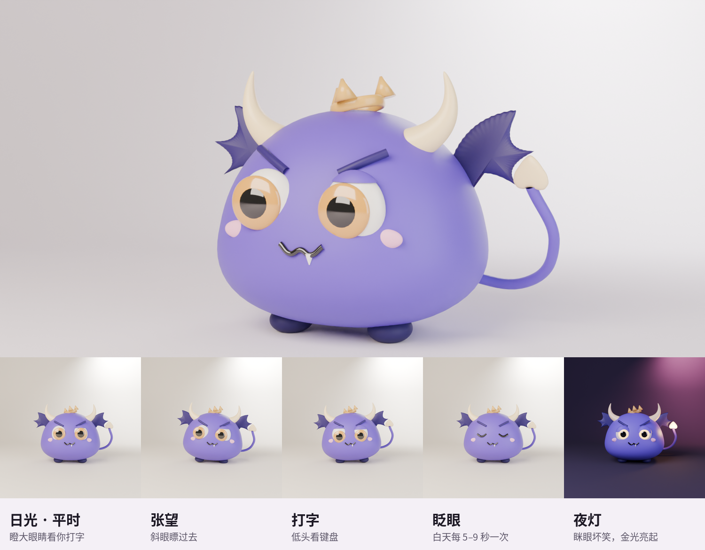

# Mosto键盘 · Mosto Keyboard（iOS）



以小鹤双拼为主（两键一字、小写字母输入）、兼容全拼的 iOS 第三方键盘，核心是 **按触点位置的自动纠错**：点偏到相邻键时，结合手指落点概率与词频，把首选纠正为最可能想打的词。

## 功能

| 项目 | 说明 |
|---|---|
| 自动纠错 | 高斯触点模型 + 词库联合解码；首选带下划线表示已纠错，第二候选为原文；空格上屏了纠错结果后立刻按删除，会撤回这次纠错，恢复成按下的字母（同 Gboard） |
| 个人习惯 | 记录常用词；学习手指相对键位中心的固定偏移 |
| 候选栏 | 只显示放得下的候选，不横向滚动；⌄ 展开全部候选（竖向） |
| 布局 | 按 Gboard iOS 实测尺寸（402 pt 屏宽）：工具栏 64、行距 53、键距 5.5×11；字母键不加数字角标 |
| 质感 | iOS 26 液态玻璃：键盘背景透明交给系统玻璃，圆角键帽；设置中可改为 Gboard 无边框样式 |
| 外观 | 自动（跟随系统浅色 / 深色，以及要求深色键盘的输入框，如聚焦搜索）、日光（系统键盘原样）、夜灯（深夜蓝，Mosto 在候选栏左边亮起金光） |
| 联想 | 默认关闭（纯净输入，同 Gboard）；可在设置里打开：上屏后推荐下一个词。最后一个候选始终是输入的字母原文 |
| 输入方案 | 小鹤双拼与全拼（含简拼、半截音节），设置里切换；两种方案都按触点自动纠错 |
| 九宫格 | 中文键盘可选九宫格（1 分词、2 ABC … 9 WXYZ；左列 ，。？——打字时换成拼音选择列，点一下即定下对应几个键；右列删除、重输、换行），小鹤双拼与全拼都能用；每个键代表它上面的几个字母，由词库判断。基准（键位全对时首选命中）：全拼 词 68%、句 55%；小鹤双拼 词 51%（双拼在九宫格上一键对应的音节多，歧义大） |
| 英文 | 英文模式按触点自动纠错并给出候选（3.9 万词）：错位、漏字母、多按一键、相邻两字母颠倒都能纠（teh → the、thnaks → thanks），dont → don't、im → I'm；空格或标点时替换，紧接着按删除可撤回。基准（σ=0.22 触点噪声）：照打原样 83.5% → 纠错后 99.1%，正确拼写的词 99.9% 不被改动 |
| 中英混输 | 中文模式下直接打完整的英文词：ok → OK、ios → iOS、iphone → iPhone、github → GitHub（不做前缀补全）；按词频和中文读法比较排序，de、he、me 等仍然先出中文。英文词表来自 [wordfreq](https://github.com/rspeer/wordfreq)（CC BY-SA 4.0），约 3.9 万词 |
| 输入框中显示 | 打字时把按下的字母（默认）或拼音写进输入框，带下划线，选了候选才替换成汉字，同系统键盘；候选栏只放候选 |
| 表情 | 😊 打开表情页：常用 + 笑脸与人物、动物与自然、食物与饮料、活动、旅行与地点、物品、符号、旗帜，上下滑动，底栏一点跳到分类；只列出当前 iOS 能显示的表情；按住 😊 打开键盘设置。列表来自 [Emojibase](https://github.com/milesj/emojibase)（MIT） |
| 速度 | 九宫格全拼一整句（27 键）解码从 70 ms 降到约 20 ms，全键盘每键 < 1 ms；词库索引和英文词表在键盘出现后于后台建好，首个按键不卡 |
| Mosto | 键盘里的薰衣草紫小魔王（谐音“魔头”）：白天在键盘设置的顶部，夜灯时待在候选栏左侧、尾巴尖亮起金光，点它打开设置；设定见 [docs/MOSTO.md](docs/MOSTO.md) |
| 符号 | 中/英两套 123、#+= 页面，与 Gboard 同排布，每页 ≤10 键/行，全部可见 |
| 数字 | `123` 默认打开九宫格数字键盘（左列 + − /，右列删除、空格、回车，0 两侧 . 和 :，长按出 = _ * , %）；“符号”进入完整数字符号页；设置里可改回全键盘；纯数字输入框自动用九宫格 |
| 无障碍 | 每个键都有 VoiceOver 读音（删除、空格、上档、中英切换等）；按键音分字母、删除、功能键三种，与系统键盘一致；震动和按键音可分别开关，按下瞬间发出 |
| 手感 | 自绘按键、整块区域统一处理触摸、多指连按不丢字、按住空格左右拖动移光标（其余键帽变空白，拖得快移得多，按字符移动、表情不拆开）、删除长按加速 |
| 隐私 | 不联网；词库和学习数据只存在本机 |

## 发布到 TestFlight（自动）

推送到 `main` 后，GitHub Actions（`.github/workflows/ios.yml`）自动：编译 → 引擎基准测试 → 归档签名 → 上传 TestFlight。

一次性准备：
1. 本仓库 Settings › Secrets and variables › Actions 添加 `ASC_KEY_ID`、`ASC_ISSUER_ID`、`ASC_KEY_P8`、`APPLE_TEAM_ID`（App Store Connect API 密钥，可与其他 App 共用）。
2. App Store Connect › App › ＋ 新建 App：平台 iOS，套装 ID `app.mossling.keyboard`（首次运行流程会自动注册该 ID 及扩展 ID `app.mossling.keyboard.ext`），名称与 SKU 自定。

构建报告推送到 `ci-logs`（编译）与 `ci-logs-testflight`（上传）分支。

## 本地安装到 iPhone

1. Mac 上用 Xcode 15 或更新版本打开 `MossOttoKeyboard.xcodeproj`，两个 target 的 Signing 选自己的 Team，真机 Run。
2. iPhone：设置 › 通用 › 键盘 › 键盘 › 添加新键盘 › Mosto键盘。可选开启“允许完全访问”（仅用于震动与按键音）。

## 键位

- 空格：上屏首选　回车：上屏字母原文　删除：逐键回退
- 底行：`123` · 😊 表情（按住打开设置）· `中/英` · 空格 · `，`（长按 `。`）· ↵
- 字母键不设长按；数字与符号在 `123` / `#+=` 页
- 表情：常用 + 八个 iOS 分类，上下滑动，底栏跳转分类；只列出当前 iOS 能显示的表情（Emojibase，MIT）
- 设置：纠错开关、纠错强度、按键震动、按键音、按键边框、清空学习数据

## 目录

```
App/        容器 App（启用说明 + 试打）
Keyboard/   键盘扩展 UI（UIKit）
Engine/     解码引擎（纯 Swift，不依赖 UIKit，可在 macOS/Linux 测试）
EngineCLI/  引擎命令行测试与模拟触点基准
Tools/      词库构建、Xcode 工程生成脚本
```

## 引擎测试（macOS / Linux）

```sh
swiftc -O Engine/*.swift EngineCLI/main.swift -o /tmp/engine
/tmp/engine Keyboard/Resources/lexicon.bin type nihcdajx   # 查看候选
/tmp/engine Keyboard/Resources/lexicon.bin bench           # 模拟触点纠错基准
```

## 重新生成词库 / 工程

```sh
# 词库：rime-ice cn_dicts 的 8105.dict.yaml 与 base.dict.yaml
python3 Tools/build_lexicon.py 8105.dict.yaml base.dict.yaml -o Keyboard/Resources/lexicon.bin
# 增删源文件后重新生成 Xcode 工程
python3 Tools/gen_xcodeproj.py
```

## 许可

词库数据来自 [雾凇拼音 rime-ice](https://github.com/iDvel/rime-ice)（GPL-3.0），因此本项目整体按 GPL-3.0 发布，见 `LICENSE`。

英文词表（中英混输）来自 [wordfreq](https://github.com/rspeer/wordfreq)，数据按 CC BY-SA 4.0 使用，生成脚本见 `Tools/build_english.py`。App 内“关于 › 隐私与开源许可”列出全部来源。

## 隐私

键盘不联网，不含任何统计、广告或崩溃上报代码。打字内容、学过的词和触点习惯只保存在设备上的键盘扩展里。“允许完全访问”只用于震动和按键音。
