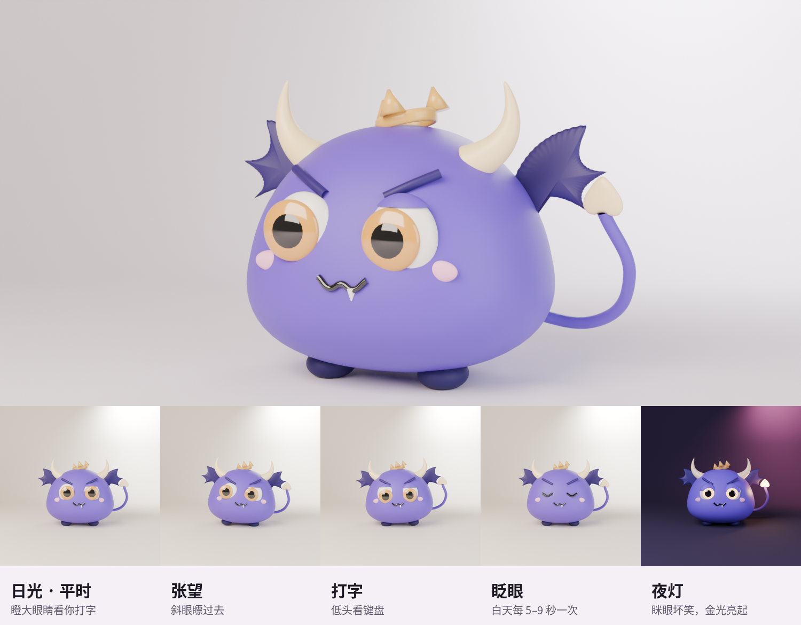

# Mosto · 键盘里的小魔王

Mosto 是这把键盘的伙伴，出自 OTTOSSOM：他是 Moss（摸索，孩子的好奇心）与 Otto（台灯，大人的陪伴）共同的另一面——抱着好东西不放的那一半属于 Moss，想躲进暗处歇一歇的那一半属于 Otto。名字念快了像“魔头”（mótóu），所以他是一只小魔王：可爱、带一点坏，不吓人，也从不被消灭；他真正需要的，是被认出来。设定以项目里的《OTTOSSOM 角色圣经定稿》为准。配色按潮玩的做法：身体只用一种主色，其余部件都收着；制作方式与摸索台灯一致：软胶质感、上釉的眼睛、产品摄影布光（`Tools/ip/ip3d.py`）。

## 1. 造型

| 部位 | 设定 |
|---|---|
| 身体 | 软糖形，下宽上圆、坐姿敦实；深紫罗兰 #633EBF，哑光软胶 |
| 王冠 | 歪戴的哑光小金冠 #E3B24A，三个尖角 |
| 角 | 一对奶油色卷角 #FFE4A8，先向外再向上内弯 |
| 翅膀 | 肩后一对小蝙蝠翅膀，波浪边，深紫 #2B1961 |
| 眼睛 | 大圆眼、琥珀色虹膜 #D69A34、大瞳孔带高光；眉毛向中间压低，眼睛可爱、眉毛使坏；两颊淡粉腮红 |
| 嘴 | 猫咪嘴坏笑，露一颗小虎牙；打哈欠时嘴竖着张开，虎牙露在上沿 |
| 尾巴 | 紫色尾巴从右后方卷上来，尖端是桃心箭头；夜灯下发金光——和 Otto 灯珠一样的金色，即被认出来以后的颜色 |
| 脚 | 两只深紫短腿 |

## 2. 性格

- **调皮，而不吓人**：坏点子都写在眉毛上，眼睛还是圆的。
- **小魔王的派头**：王冠永远戴歪，从不摘下。
- **两半**：拿东西、抱着不放是 Moss 的那一半；退到暗处、打一个很慢的哈欠是 Otto 的那一半。
- **夜灯下被认出来**：眯眼坏笑，尾巴尖亮起和灯珠一样的金光。

## 3. 在键盘里的表现

- **不说话**：没有台词和气泡。
- **一直在候选栏左边自由呼吸**：Mosto 图标无硬框停靠于候选栏左角（右邻「颜文字」入口，右侧对齐日光/夜灯切换图标与设置开关，基线完全统一）：日光下大圆眼，每 5–9 秒快速眨一次眼（110 毫秒）；夜灯下眯眼坏笑、尾巴尖亮起暖金光。键盘主体采用零重影高定哑光质感（日光奶瓷白 / 夜灯深曜石炭紫）与 `中/英`、`Shift` 4.5pt 硬件微灯珠、宽空格居中盲打定位凹痕，去除了外溢装饰物与全屏合成遮罩；伴侣应用同时呈现 Moss、Otto 与 Mosto 的三人桌面互动舞台。
- **让位给候选**：一开始打字就让开；停下后迅速柔和淡入（无缩放错拍），连打时不会在字与字之间闪现。键盘设置的顶部也有他。
- **干脆的慢哈欠**：夜灯下键盘空闲 30 秒，他打一个哈欠（直接切换帧面、零交叉溶解重影），持续约 7 秒后再合上，开始打字立刻收起。
- **不挡打字**：开始输入时隐藏；连续快打（<130ms）自动抑制遮挡邻键的按键气泡。
- **表情页**：最后一个分类“Mosto 颜文字”以他的脸作图标，开头是他的 ψ(｀∇´)ψ。
- **照顾所有用户**：开启“减弱动态效果”时不眨眼、不打哈欠。旁白可读作与触及“Mosto 颜文字”“切换日光与夜灯”。

## 4. 日光与夜灯

| | 日光 | 夜灯 |
|---|---|---|
| 键盘底 | 系统液态玻璃原样（零全屏遮罩） | 系统液态玻璃 + 深曜石炭紫哑光键帽自成暗夜对比（零无限动画） |
| 键帽 | 温润奶瓷白 `#FCFBF8` + 灰薰衣草功能键 + 暖哑金回车 | 深曜石炭紫 `#2D283E` + 深烟煤功能键 + 暖哑金回车 |
| 文字 | 深靛墨 `#22193D` | 暖月白 `#F3EDE2` |
| Mosto | 无硬框停靠在候选栏左角，大圆眼，偶尔眨眼 | 同一位置，眯眼坏笑，尾巴尖发金光；空闲 30 秒打哈欠 |

外观有三个选项：
- **自动**：跟随系统浅色 / 深色。
- **日光**、**夜灯**：固定其中一种；与系统不同时，键盘铺一层自己的底色，仍读得出是日光或夜灯。

## 5. 资产

| 文件 | 用途 | 生成命令 |
|---|---|---|
| `Keyboard/Resources/mosto_day.png` / `mosto_blink.png` / `mosto_night.png` / `mosto_yawn.png` | 键盘（设置顶部、候选栏、表情页） | `python Tools/ip/mosto3d.py sprites <dir> [--only yawn]`，再缩到 144×144 |
| `App/Assets.xcassets/AppIcon.appiconset` | App 图标 | `python Tools/ip/mosto3d.py icon <png>` |
| `docs/images/mosto_sheet.png` | 角色设定图 | `python Tools/ip/mosto3d.py sheet <dir>` |

渲染需要 Blender 的 Python 模块：`pip install bpy`（Python 3.11）。备选配色：`--palette vermilion`（朱砂红）、`--palette coral`（蜜桃珊瑚）。
